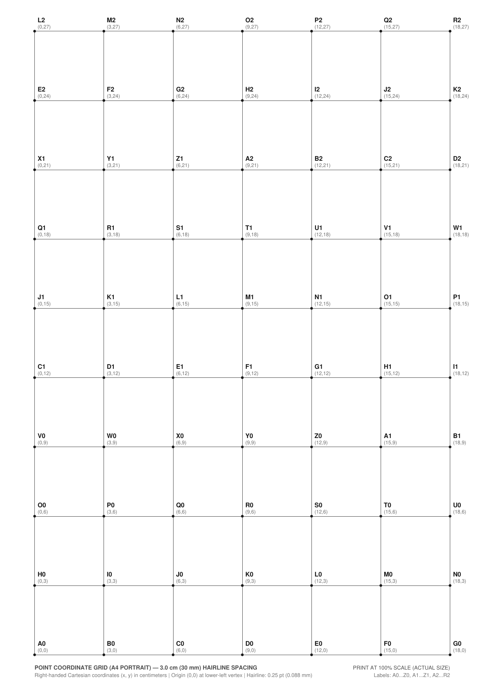

# Printable A4 Point-Anchored Coordinate Grid (Centimeter Coordinates)

The coordinate grid has been updated to anchor all labels and coordinates directly to each **grid intersection point (vertex)** rather than the square interiors. Coordinates are formatted in real-world centimeters starting from the lower-left corner.

---

## 1. Specifications & Geometric Breakdown

| Parameter | Specification | Value in PDF Points | Details |
| :--- | :--- | :--- | :--- |
| **Page Size** | A4 Portrait | $595.28 \times 841.89\text{ pt}$ | $210\text{ mm} \times 297\text{ mm}$ |
| **Grid Spacing** | $3.0\text{ cm}$ ($30\text{ mm}$) | $85.039\text{ pt}$ | Exact $10\text{ mm} = 28.3465\text{ pt}$ conversion |
| **Line Weight** | Hairline | $0.25\text{ pt}$ ($\approx 0.088\text{ mm}$) | Dark charcoal vector stroke |
| **Grid Intersections** | $7\text{ columns} \times 10\text{ rows} = 70\text{ points}$ | $510.24 \times 765.35\text{ pt}$ | Spans $0\text{ to }18\text{ cm}$ (X) and $0\text{ to }27\text{ cm}$ (Y) |
| **Page Margins** | Horizontal: $15.0\text{ mm}$<br>Vertical: $13.5\text{ mm}$ | X: $42.52\text{ pt}$<br>Y: $38.27\text{ pt}$ | Centered on page; well within safe printer margins |
| **Origin & Direction** | Lower-Left Vertex $(0,0)$ | Right-Handed | $+X$ points right, $+Y$ points up |
| **Point Marker** | Solid Vertex Dot | Diameter $1.2\text{ mm}$ | Centered on line intersections |
| **Coordinates** | Physical Centimeters | $(0,0), (3,0), (6,0)\dots(18,27)$ | In centimeters as specified |
| **Vertex Names** | Sequential Base-26 rollover | $\text{A0}\dots\text{Z0}, \text{A1}\dots\text{Z1}, \text{A2}\dots\text{R2}$ | Exactly 70 points |

---

## 2. Point-Anchoring & Collision Audit

Every point is individually marked with a solid vertex dot and labeled in its upper-right quadrant with:
1. **Name** in bold (7.8 pt `Helvetica-Bold`).
2. **Centimeter Coordinate** right underneath (6.2 pt `Helvetica`).
3. The interior of the 3 cm squares is intentionally left completely empty so that labels cannot be mistaken for square identifiers.

```text
=== POINT-GRID COLLISION AUDIT REPORT ===
Total text elements inspected:       140
Text-to-text collisions:             0
Page boundary violations (<4.5mm):   0
Minimum text-to-text clearance:      0.56 mm (between stacked Name & Coord lines)
Minimum margin to sheet edge:        6.77 mm (printer-safe across all edges)
Status:                              ALL CHECKS PASSED
```

---

## 3. Rendered Output Preview



---

## 4. Download & Print Instructions

- **PDF Document:** [coordinate_grid_a4.pdf]
- **Generator Script:** [generate_coordinate_grid.py]

> [!IMPORTANT]
> When printing:
> 1. Set **Page Sizing & Handling** / **Scale** to **Actual Size** (or **100%**).
> 2. Ensure **Fit to printable area** or **Shrink oversized pages** is disabled so the points measure exactly $3.0\text{ cm}$ apart on paper.
